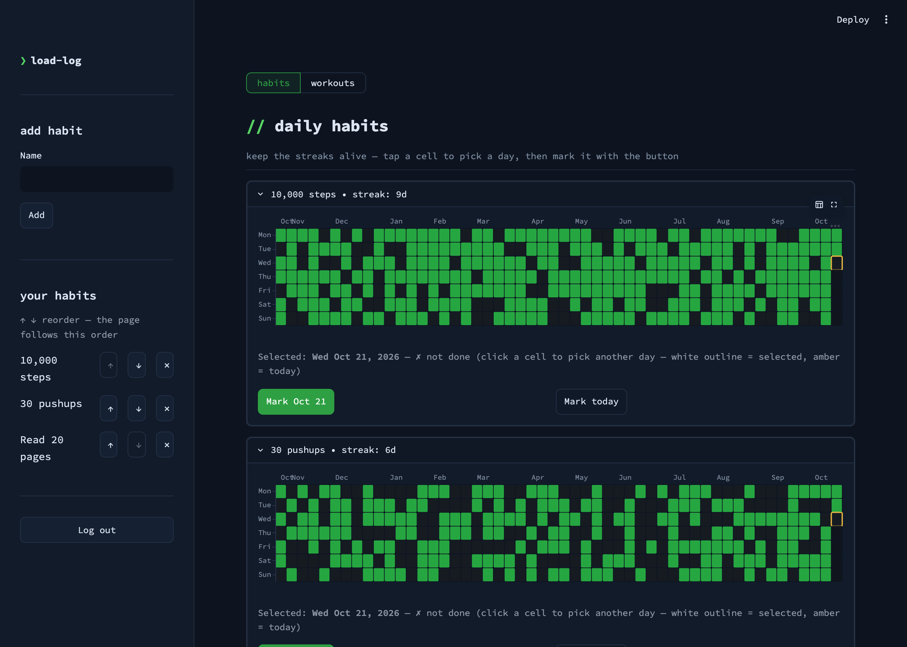
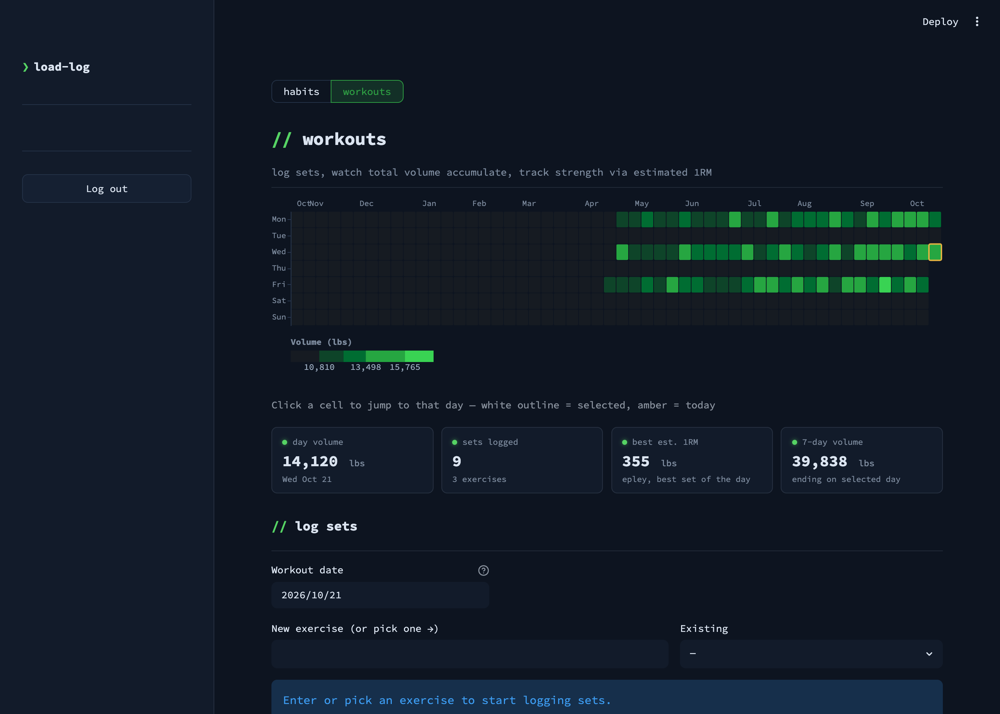
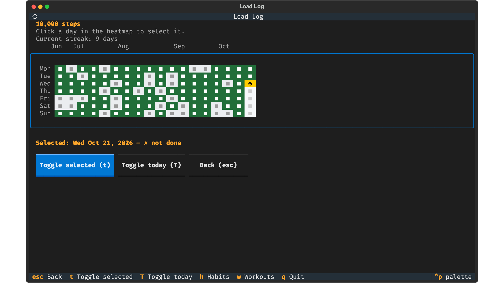

# load-log

A personal health tracker for daily habits and strength training. It has two
interfaces over the same data:

- **Web** (Streamlit): browser UI with GitHub-style heatmaps, charts and inline
  editing.
- **TUI** (Textual): terminal UI, keyboard-driven, opens instantly.

It exists to make logging a habit or a lifting set take a few keystrokes, from
any device, and to show at a glance whether streaks and training volume are
holding up.



## What it does

- **Habit tracker.** Define daily habits (for example "10,000 steps"). Each one
  gets a 52-week heatmap and a current streak. Click any day on the heatmap to
  select it, then mark or unmark it. Habits can be added, reordered and deleted.
- **Workout tracker.** Log sets (exercise, reps, weight) for any date. A volume
  heatmap (reps x weight per day) picks the date, the form shows what you did
  last time for that exercise, pre-fills the next set, and suggests the next
  weight for progressive overload. Logged sets can be edited or deleted inline;
  per-exercise history shows total volume and estimated 1RM (Epley) over time.





Screenshots use synthetic data from a local stub client, not a real account.

## How it works

Neither UI reads or writes its data in Postgres directly. Both log in
in-process through the postgrest-auth library (it checks `load_log.users` over
the superuser connection and signs a JWT), then read and write through
PostgREST over HTTP:

```
 TUI / Web ──login(username,password)──▶ postgrest-auth ──▶ JWT (role=load_log_user, user_id)
     │        (in-process library; reads load_log.users        │
     │         over the superuser connection)                  │
     └────────── api_client.py ──Authorization: Bearer <jwt>──▶ PostgREST ──▶ Postgres
                 (requests; returns dict/list[dict]/DataFrame)        (apps DB · load_log schema)
```

- Data lives in the **`load_log` schema** of a shared **`apps`** database. The
  app's data is reached only via PostgREST; Postgres enforces access through the
  `load_log_user` role.
- All data access is in [`backend/src/api_client.py`](backend/src/api_client.py),
  shared by the web app and the TUI. The UIs contain no SQL.
- PostgREST is shared server infrastructure (added once, serves every app).
  Login is the [`postgrest-auth`](https://github.com/ReadableCode/postgrest-auth)
  library, a git dependency pinned to a tag in `backend/pyproject.toml`: it
  verifies the password (argon2id, legacy bcrypt rehashed on login, 5-failure /
  15-minute lockout per username and per IP) and signs the JWT with PostgREST's
  secret.
- Direct Postgres connections remain only in login (reading `load_log.users`),
  the startup schema bootstrap and the `scripts/` helpers.

For full design and schema details see [`backend/docs/`](backend/docs/) and
[`CLAUDE.md`](CLAUDE.md).

## Run it with Docker

`compose.yaml` is a self-contained stack: Postgres, PostgREST and the web app.
Nothing else needs to be installed or running. Put three secrets in a `.env`
file next to it (letters and digits only, since they end up in a connection
URL and SQL):

```sh
git clone https://github.com/ReadableCode/load-log.git
cd load-log
printf 'POSTGRES_PASSWORD=%s\nPOSTGREST_DB_PASSWORD=%s\nPOSTGREST_JWT_SECRET=%s\n' \
    "$(openssl rand -hex 32)" "$(openssl rand -hex 32)" "$(openssl rand -hex 32)" > .env
docker compose up --build
```

There is no sign-up page, so create your account from a second terminal (it
writes one row to `load_log.users` with an argon2id hash and refuses to
overwrite an existing username):

```sh
docker compose exec load-log-streamlit uv run python scripts/create_user.py --username you --password 'your-password'
```

Then open http://localhost:8505 and log in. On its first start Postgres
creates the two roles PostgREST connects with; the app creates its own schema,
its `load_log_user` role and its tables, whether the page or `create_user.py`
runs first. Data lives in the `postgres_data` volume. Only the web app's port
is published; set `LOAD_LOG_PORT` in `.env` to use another host port.
Bootstrap ends with `NOTIFY pgrst` so PostgREST reloads its cache; if it still
404s a table right after the first boot, `docker compose restart postgrest`.

Already running Postgres and PostgREST? `compose.external.yaml` runs the app
alone against them; its header lists the `.env` settings and the two roles
your Postgres needs:

```sh
docker compose -f compose.external.yaml up --build
```

On macOS, Docker runs through [colima](https://github.com/abiosoft/colima). Start
it once per session: `colima start` (or `colima start --cpu 4 --memory 6`).

## Prerequisites (without Docker)

- Python 3.13 (pinned in `backend/.python-version`)
- [uv](https://docs.astral.sh/uv/): `brew install uv` (macOS) or
  `curl -LsSf https://astral.sh/uv/install.sh | sh` (Linux)
- A reachable PostgREST and Postgres of your own (the Docker stack above
  publishes only the web app, so it is not a backend for the bare-metal
  clients)
- A login user in `load_log.users` (create one with `scripts/create_user.py`,
  below)

## One-time setup

```bash
git clone https://github.com/ReadableCode/load-log.git
cd load-log

cp .env.example .env
$EDITOR .env                # see keys below
cd backend && uv sync
```

`.env` keys:

```env
# Clients (web + TUI). Without it set, the code falls back to the author's own
# deployment (default in backend/src/api_client.py); set it to point at your
# server.
POSTGREST_URL=https://pgrest.example.com

# PostgREST's JWT secret: login (web + TUI) signs the session JWT with it.
POSTGREST_JWT_SECRET=<postgrest-jwt-secret>

# The TUI is non-interactive: it logs in with these at startup.
LOAD_LOG_USERNAME=<your-username>
LOAD_LOG_PASSWORD=<your-password>

# Direct-DB: login (web + TUI read load_log.users), the startup schema bootstrap
# and scripts/. Not the data path.
POSTGRES_URL=<host of the shared Postgres>
POSTGRES_PORT=5432
POSTGRES_USER=<user>
POSTGRES_PASSWORD=<password>
POSTGRES_DB=apps
```

Create your login user (converges the schema first, then writes one row to
`load_log.users` with an argon2id hash; refuses to overwrite an existing
username):

```bash
cd backend && uv run python scripts/create_user.py --username you --password 'your-password'
```

## Run locally (bare-metal)

From `backend/`:

```bash
# Web (Streamlit), http://localhost:8501, shows a login form
PYTHONPATH=src uv run streamlit run src/web/app.py

# TUI, logs in using LOAD_LOG_USERNAME / LOAD_LOG_PASSWORD from .env
PYTHONPATH=src uv run python -m tui.app
```

Both use `POSTGREST_URL`, `POSTGRES_*` and `POSTGREST_JWT_SECRET` from `.env`.
To develop without a server, [`backend/dev/`](backend/dev/README.md) has a
stub `api_client` with synthetic data for previewing the web UI with no network.

### TUI cheatsheet

Anywhere:

- `h` / `w` / `q`: habits screen / workouts screen / quit

Habits list:

- `↑` / `↓`: move highlight between habits
- `enter`: open the heatmap detail view for the highlighted habit
- `space`: toggle today on the highlighted habit
- `delete`: delete the highlighted habit
- `a`: focus the "new habit" input

Habit detail and workouts heatmap:

- click any cell: select that date
- `t` / `T`: toggle the selected day / jump back to today

Workouts log-a-set form:

- `enter` in reps: jump to weight (or submit if weight is already filled)
- `enter` in weight: submit the set
- weight accepts decimals (e.g. `47.5`)
- `Edit` / `Delete` button on each logged set: inline edit or remove

The Footer at the bottom of every screen is the source of truth for the
keyboard shortcuts available right now, and each Footer entry is clickable.

## DB schema (app-owned bootstrap)

Schema changes go in the idempotent SQL files under [`deploy/`](deploy/), applied
by [`backend/src/bootstrap.py`](backend/src/bootstrap.py) from the app's own
startup: the Streamlit script (on its first page load), the TUI's `main()`
and `scripts/create_user.py`, never the docker entrypoint. Starting load-log any way at all converges the schema, so the code
and the database cannot disagree because of how you launched it. A failed
bootstrap is logged and the app serves anyway; the next boot retries.

Convergence is gated on an integer `SCHEMA_VERSION` stamped into
`load_log.deploy_meta`, so it is a no-op on every boot after the first. The SQL
is additive and idempotent only: `CREATE ... IF NOT EXISTS`,
`ADD COLUMN IF NOT EXISTS`, never `DROP`, `TRUNCATE`, or `ALTER COLUMN`. A
destructive change is a new numbered file plus a reviewed `SCHEMA_VERSION` bump,
not something a boot can do by surprise.

To add a column: edit `deploy/02_schema.sql` (or add `deploy/04_*.sql` and put it
in `SCHEMA_FILES`), bump `SCHEMA_VERSION`, restart. Run it by hand if needed:

```bash
cd backend && uv run python src/bootstrap.py
```

The bootstrap expects the cluster-wide PostgREST roles (`postgrest_authenticator`,
`web_anon`) to exist already; it stops with an error naming them if they do not.

This replaced Alembic in 2026-08. The four revisions that built the schema up to
this point are in git history; `deploy/historic/` holds the one-shot SQL that has
already run and must not run again.

Take a read-only CSV/Parquet backup before any risky change:

```bash
cd backend && uv run --with pyarrow python scripts/backup_to_files.py   # writes data/backup_<ts>/
```

## Lint / format / type-check / test

```bash
cd backend
uv run flake8 src/
uv run black src/ && uv run isort src/
uv run mypy src/
uv run pytest tests/
```

The tests are read-only conformance checks against the real Postgres and
PostgREST configured in `.env` (schema, grants, login, that `load_log.users` is
not reachable over HTTP). There is no skip path: an unreachable dependency is a
failing test.

## Production deployment

In production the shared `postgrest` service and the
`load-log-streamlit` service (its compose fragment is under
[`deploy/`](deploy/)) run from a
separate Docker compose repo on a home server, behind a SWAG reverse proxy. The
app applies its own schema from [`deploy/`](deploy/) at startup; the
cluster-wide PostgREST roles come from a `postgres-cluster-roles` service in the
same compose setup. Deploy commands and the systemd unit live in that Docker
repo.
