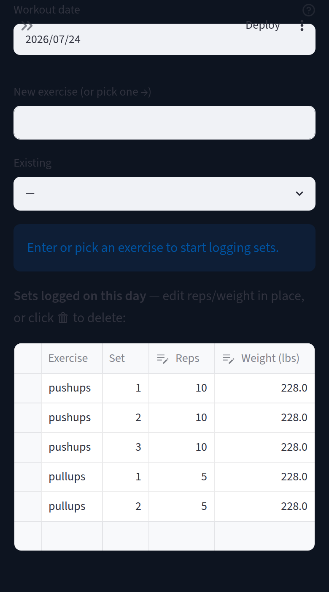
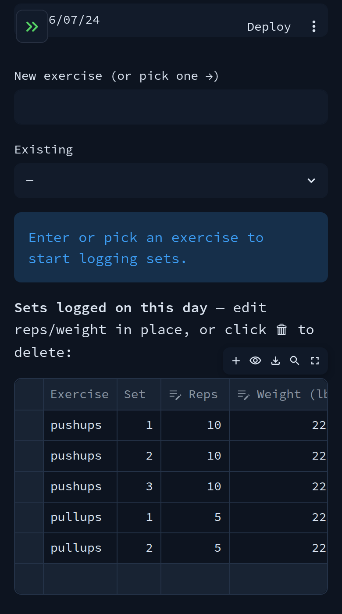
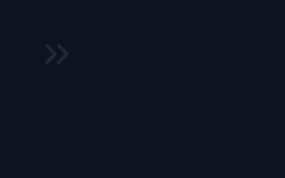
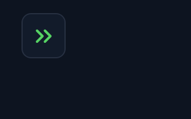
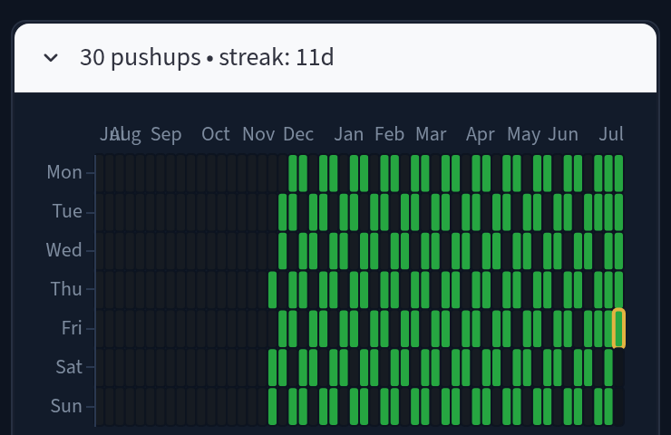
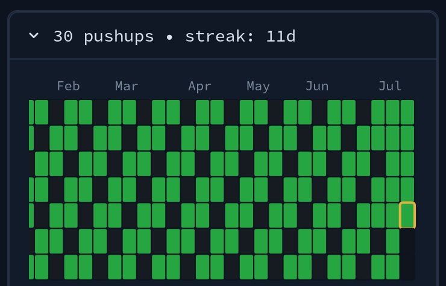
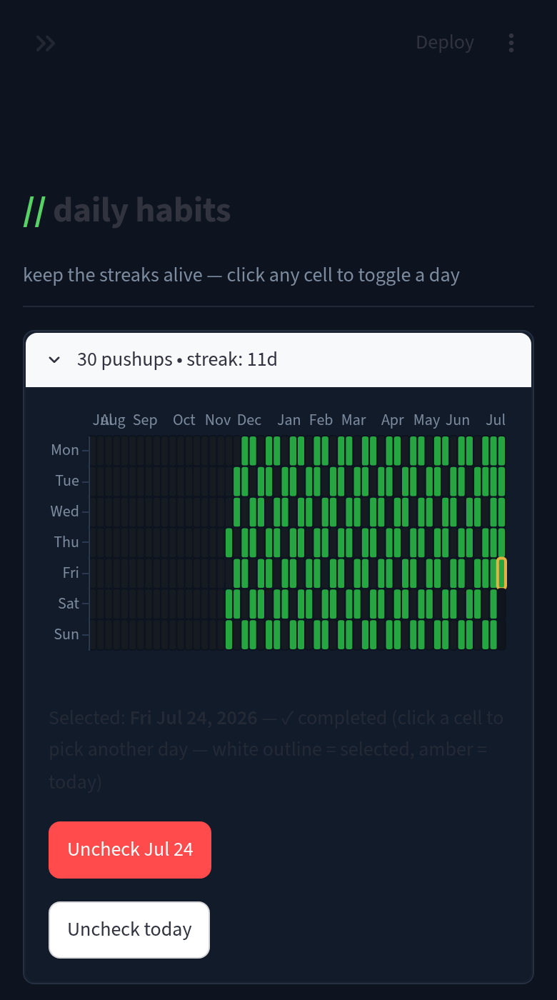
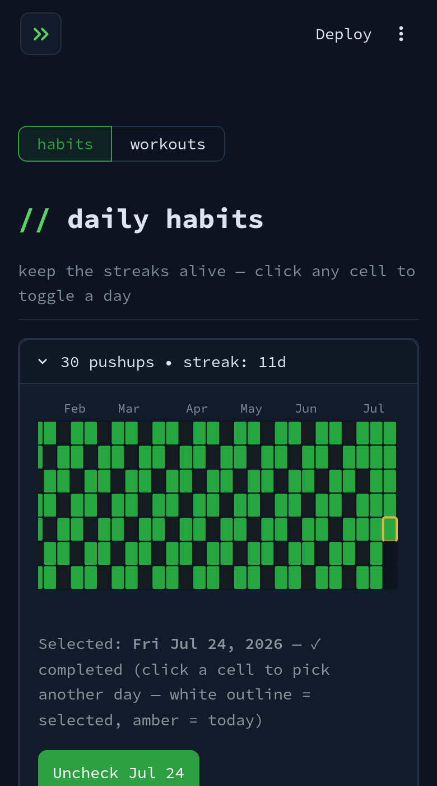

# Mobile fixes — before / after

Screenshots for the mobile dark-theme / navigation PR, captured at an
iPhone-sized viewport (390px wide, 2x scale). "Before" is master run without
`.streamlit/config.toml`, reproducing the deployed light theme; "after" is the
PR branch with the theme config loaded.

## 1. Dark theme on dataframes and widgets

| Before | After |
| --- | --- |
|  |  |

## 2. Sidebar expand button

| Before | After |
| --- | --- |
|  |  |

## 3. Heatmap cell size on narrow screens

Before: 52 weeks squeezed into 390px — sliver cells. After: the card scrolls
sideways, opens on the most recent weeks, and cells stay tappable.

| Before | After |
| --- | --- |
|  |  |

## 4. Page navigation in the main column

Before: no navigation visible anywhere on the page (it lived in the collapsed
sidebar). After: habits/workouts segmented control at the top.

| Before | After |
| --- | --- |
|  |  |
